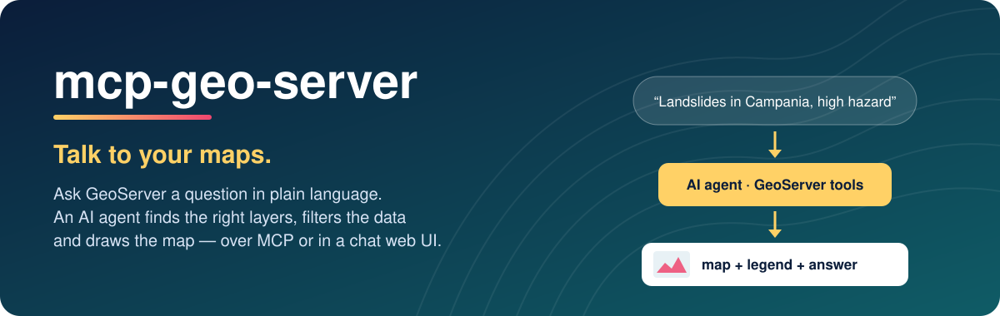
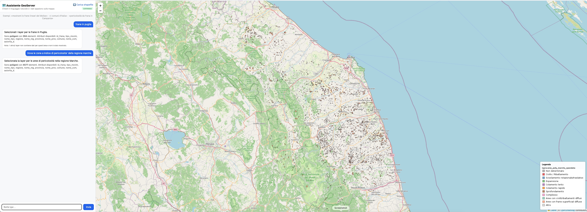
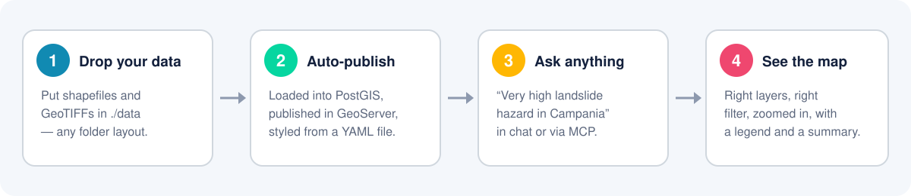
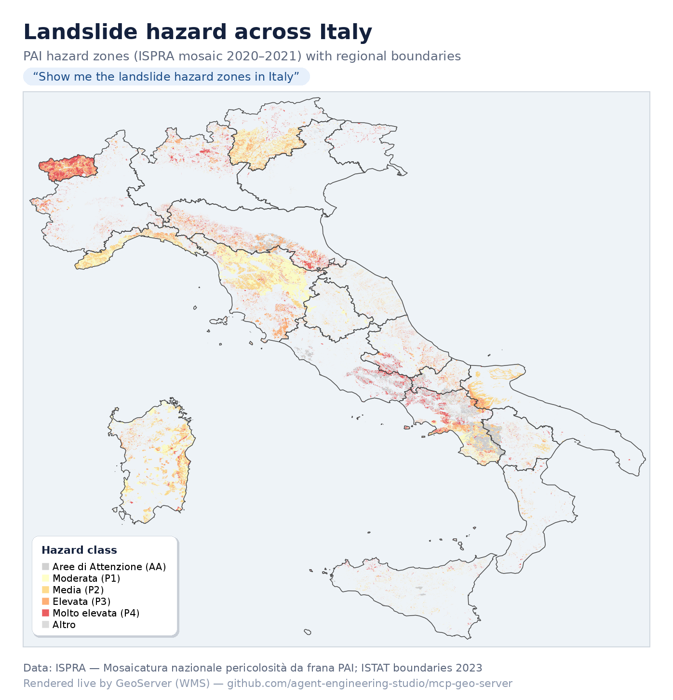
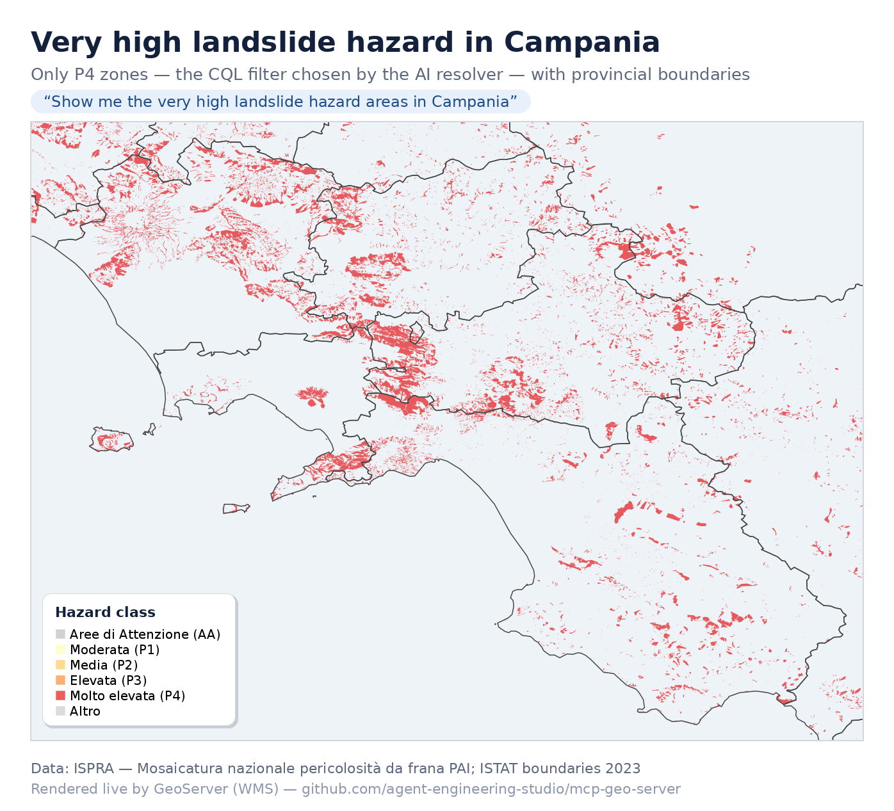
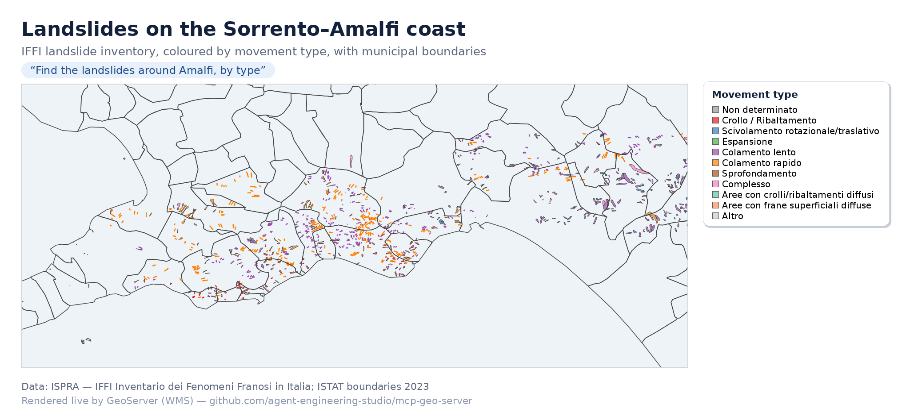
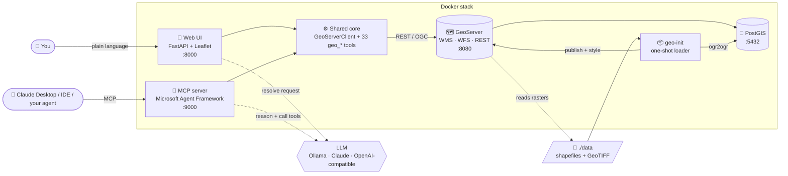
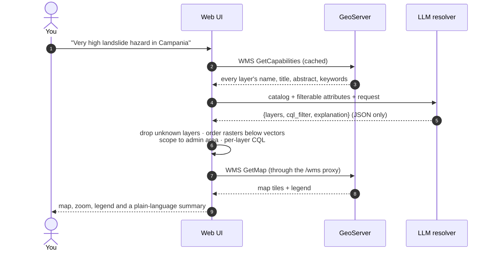
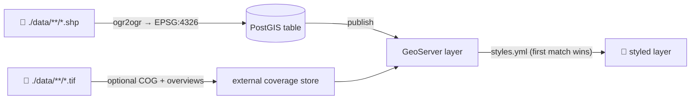

<p align="center">
  
</p>

<p align="center">
  <a href="LICENSE"></a>
  
  
  
  
  
</p>

<p align="center">
  <b>Ask your GeoServer a question in plain language. Get back the right map.</b><br>
  An open-source AI agent and chat-and-map web app that turns words into maps.
</p>

---

## What is this?

**[GeoServer](https://geoserver.org)** is one of the most widely used open-source
map servers. It is powerful, but getting the map you want means knowing layer
names, filter syntax, styles and REST calls.

**mcp-geo-server puts an AI agent in front of it.** You type what you want to see,
for example:

> *"Show me the very high landslide hazard areas in Campania"*

The agent then:

1. reads what your GeoServer actually publishes;
2. picks the right layer;
3. builds the right filter;
4. zooms to the right place;
5. draws the map with a legend and a short description of the data.

You can use it in three ways:

| | How | Good for |
|---|---|---|
| 💬 **Chat + map web UI** | open <http://localhost:8000> | exploring data, demos, non-GIS colleagues |
| 🧠 **MCP server** | plug it into Claude Desktop, an IDE, or your own agent | letting *any* AI assistant work with your maps |
| 📦 **Data bootstrap** | drop files in `./data`, run `make up` | turning a folder of shapefiles and GeoTIFFs into a live map server |



*Chat on the left, map on the right. Here the request was for the landslide
areas of the Marche region, coloured by type of movement.*

---

## How it works

<p align="center">
  
</p>

Nothing in the code is tied to one dataset. The agent learns what is available
from GeoServer itself, from each layer's name, title, abstract and keywords. A
YAML file sets the styles. **Point it at any GeoServer and it works with your data.**

The demo stack ships ready for Italian open data on natural hazards: ISPRA
landslide and flood maps, ISTAT boundaries, CORINE land cover and geology. That
is what the maps below show.

---

## Map gallery

Every map below was drawn live by GeoServer from the demo data. The quote on
each card is the kind of request that leads to it.

<table>
  <tr>
    <td width="50%"></td>
    <td width="50%"></td>
  </tr>
  <tr>
    <td><b>Landslide hazard across Italy.</b> The national PAI hazard mosaic (about 930,000 polygons), coloured from moderate (P1) to very high (P4).</td>
    <td><b>Only the very high zones in Campania.</b> The AI chose the filter <code>per_fr_ita = 'Molto elevata P4'</code> on its own. See the real response <a href="#a-real-request-end-to-end">below</a>.</td>
  </tr>
  <tr>
    <td colspan="2"></td>
  </tr>
  <tr>
    <td colspan="2"><b>Landslides on the Sorrento–Amalfi coast.</b> The IFFI national landslide inventory, coloured by movement type (slow flow, rapid flow, fall, slide…), with municipal boundaries.</td>
  </tr>
</table>

### An interactive map, right here on GitHub

GitHub draws GeoJSON as a live map. Below are a few real landslide points from
the IFFI inventory around Agerola, on the Amalfi coast, fetched from GeoServer
over WFS. Click a marker to see its movement type. The full sample is in
[`docs/examples/amalfi-landslides.geojson`](docs/examples/amalfi-landslides.geojson).

```geojson
{"type":"FeatureCollection","features":[{"type":"Feature","properties":{"movement":"Slow flow","municipality":"Agerola","marker-color":"#984ea3"},"geometry":{"type":"Point","coordinates":[14.5596,40.6432]}},
{"type":"Feature","properties":{"movement":"Slow flow","municipality":"Agerola","marker-color":"#984ea3"},"geometry":{"type":"Point","coordinates":[14.5534,40.6573]}},
{"type":"Feature","properties":{"movement":"Slow flow","municipality":"Agerola","marker-color":"#984ea3"},"geometry":{"type":"Point","coordinates":[14.5524,40.6465]}},
{"type":"Feature","properties":{"movement":"Rapid flow","municipality":"Agerola","marker-color":"#ff7f00"},"geometry":{"type":"Point","coordinates":[14.5602,40.6581]}},
{"type":"Feature","properties":{"movement":"Slow flow","municipality":"Agerola","marker-color":"#984ea3"},"geometry":{"type":"Point","coordinates":[14.5673,40.6392]}},
{"type":"Feature","properties":{"movement":"Slow flow","municipality":"Agerola","marker-color":"#984ea3"},"geometry":{"type":"Point","coordinates":[14.5527,40.6567]}},
{"type":"Feature","properties":{"movement":"Slow flow","municipality":"Agerola","marker-color":"#984ea3"},"geometry":{"type":"Point","coordinates":[14.5583,40.6476]}},
{"type":"Feature","properties":{"movement":"Slow flow","municipality":"Agerola","marker-color":"#984ea3"},"geometry":{"type":"Point","coordinates":[14.5645,40.6344]}},
{"type":"Feature","properties":{"movement":"Rapid flow","municipality":"Agerola","marker-color":"#ff7f00"},"geometry":{"type":"Point","coordinates":[14.5591,40.6287]}},
{"type":"Feature","properties":{"movement":"Rapid flow","municipality":"Agerola","marker-color":"#ff7f00"},"geometry":{"type":"Point","coordinates":[14.5604,40.6544]}},
{"type":"Feature","properties":{"movement":"Slow flow","municipality":"Agerola","marker-color":"#984ea3"},"geometry":{"type":"Point","coordinates":[14.5554,40.6574]}},
{"type":"Feature","properties":{"movement":"Slow flow","municipality":"Agerola","marker-color":"#984ea3"},"geometry":{"type":"Point","coordinates":[14.5692,40.6451]}}]}
```

---

## A real request, end to end

The request below went to the web UI's `/api/ask` endpoint while the demo stack
was running. The Campania card above draws this same filter, zoomed on the region:

```bash
curl -s -X POST http://localhost:8000/api/ask \
  -H 'content-type: application/json' \
  -d '{"query": "show me the very high landslide hazard areas in Campania"}'
```

This is the answer the AI built, shortened slightly for reading. It chose one
of more than 100 published layers and a filter on a real attribute value.
The demo model answered in Italian.
It also returned everything a map needs:

```jsonc
{
  "layers": ["ispra:mosaicatura_ispra_2020_2021_aree_pericolosita_frana_pai"],
  "cql_filter": "per_fr_ita = 'Molto elevata P4'",
  "explanation": "La richiesta chiede le aree di pericolosità molto elevata (P4) per i frane in Campania…",
  "info": [{
    "qualified": "ispra:mosaicatura_ispra_2020_2021_aree_pericolosita_frana_pai",
    "kind": "vector",
    "geometry": "poligoni",
    "fields": ["per_fr_ita"],
    "count": 928542
  }],
  "cql_by_layer": {
    "ispra:mosaicatura_ispra_2020_2021_aree_pericolosita_frana_pai": "per_fr_ita = 'Molto elevata P4'"
  },
  "bbox": {"minx": 6.65, "miny": 35.49, "maxx": 18.52, "maxy": 47.00}
}
```

The AI was never told that `per_fr_ita` exists or that "very high" maps to
`'Molto elevata P4'`. It worked that out from the GeoServer catalog and the
style config, as explained in [How the AI picks layers](#how-the-ai-picks-layers).

### Things you can ask

The resolver understands requests in **English, Italian or any language your
LLM speaks**. Some examples with the demo data:

| You ask | What happens |
|---|---|
| *"Find the landslides in Puglia"* | picks the Puglia layers from the IFFI landslide inventory |
| *"mostrami le frane lineari del Molise"* | picks the line-type landslides layer for Molise |
| *"Very high landslide hazard in Campania"* | hazard layer + `per_fr_ita = 'Molto elevata P4'` filter |
| *"Flood hazard areas around Bologna"* | flood-hazard layer, zoomed to and clipped by the municipality boundary |
| *"High hazard areas with average slope and elevation"* | hazard layer + **terrain analysis** from a DTM: mean / min / max slope and elevation |
| *"How many features are in topp:states?"* (via MCP) | the agent calls GeoServer and answers with the count |

---

## Quick start (about 5 minutes)

You need **Docker** with Compose and an **LLM**. The default LLM is a local
[Ollama](https://ollama.com); see [Choose your LLM](#choose-your-llm) for Claude,
Ollama Cloud or any OpenAI-compatible endpoint.

```bash
git clone https://github.com/agent-engineering-studio/mcp-geo-server.git
cd mcp-geo-server

ollama serve &            # local LLM (skip if already running)
make ollama-pull          # download the model onto the host Ollama
make build                # build images (native on Intel and Apple Silicon)
make up                   # start everything
```

Then open:

| What | Where |
|---|---|
| 💬 Chat + map web UI | <http://localhost:8000> |
| 🧠 MCP server (streamable HTTP) | <http://localhost:9000/mcp> |
| 🗺️ GeoServer admin | <http://localhost:8080/geoserver> (`admin` / `geoserver`) |
| 🐘 PostGIS | `localhost:5432` (`gis` / `gis` / `gis`) |

**Add your data.** Put shapefiles (`.shp` with their sidecar files) and GeoTIFFs
(`.tif`) anywhere under `./data`, in any folder layout, and run `make init`.
Every file becomes a published, styled GeoServer layer. You can also upload a
zipped shapefile from the web UI at <http://localhost:8000/upload>.

> **Using the Italian demo data?** It is open data and is not bundled in this
> repo, because `data/` is gitignored. Download it from
> [ISPRA IdroGEO open data](https://idrogeo.isprambiente.it/app/page/open-data)
> (IFFI inventory, PAI landslide and flood hazard mosaics) and
> [ISTAT administrative boundaries](https://www.istat.it/it/archivio/222527),
> unzip it into `./data`, and run `make init`.

---

## Use it from your AI assistant (MCP)

The [Model Context Protocol](https://modelcontextprotocol.io) is an open standard
that lets AI assistants use external tools. mcp-geo-server exposes **one smart
tool**, `geoserver-agent`, that takes a plain-language `task`. Behind it, an agent
built with the [Microsoft Agent Framework](https://github.com/microsoft/agent-framework)
chooses among **33 GeoServer operations**.

**Claude Desktop** (or any MCP client that runs a local process), in
`claude_desktop_config.json`:

```json
{
  "mcpServers": {
    "geoserver": {
      "command": "mcp-geo-server",
      "env": {
        "GEOSERVER_URL": "http://localhost:8080/geoserver",
        "GEOSERVER_USER": "admin",
        "GEOSERVER_PASSWORD": "geoserver",
        "GEO_LLM_PROVIDER": "ollama",
        "OLLAMA_LLM_MODEL": "qwen2.5"
      }
    }
  }
}
```

The `mcp-geo-server` command comes from `pip install -e .` (see
[Local development](#local-development-no-docker)).

**Over HTTP from your own code** (the Docker stack already runs this server on
port 9000):

```python
from mcp import ClientSession
from mcp.client.streamable_http import streamablehttp_client

async with streamablehttp_client("http://localhost:9000/mcp") as (r, w, _):
    async with ClientSession(r, w) as s:
        await s.initialize()
        res = await s.call_tool("geoserver-agent",
                                {"task": "List the workspaces and how many layers each has"})
        print(res.content[0].text)
```

> 🔒 **Safe by default.** Destructive operations (deleting layers, stores and
> styles, and WFS-T edits) are blocked by a guard in front of the tools unless
> you set `GEO_ALLOW_DESTRUCTIVE=true`.

---

## Architecture

All components share **one async core** (`GeoServerClient` plus the `geo_*`
functions): the MCP agent, the web UI and the data bootstrap. Only that core
talks to GeoServer.



### What happens when you ask



---

## How the AI picks layers

`POST /api/ask` maps a request to layers with **no hardcoded vocabulary**:

1. **The catalog comes from GeoServer.** The WMS GetCapabilities document gives
   each published layer's real `name`, `title`, `abstract` and `keywords`.
2. **A small LLM "resolver" matches the request.** It has no tools, and its
   reply is constrained by a JSON Schema built for each request: the layer
   names are an `enum` of the real catalog, so the model can't produce a layer
   that doesn't exist. The reply carries the layer name(s), an optional
   `cql_filter`, a short explanation and a `confidence`. If a backend rejects
   the schema (some OpenAI-compatible servers do), the call is retried once
   without it, and names not in the catalog are still dropped. Set
   `GEO_RESOLVER_STRUCTURED=false` to skip the schema altogether.
3. **Filters use real values.** The style config lists the filterable
   attributes, their allowed values and the layers that carry them. With that,
   the resolver writes a filter like `per_fr_ita = 'Elevata P3'` for "high
   hazard", on a layer that really has that attribute.
4. **Filters are checked before they reach WMS** (`mcp_geo_server/cql.py`).
   The filter is parsed into a small, attribute-only subset of CQL: no
   functions and no spatial predicates. Its attributes must exist on the
   selected layers and categorical values must be the exact configured ones.
   It is then rewritten in canonical form. A filter that fails is dropped,
   the map shows the unfiltered data, and the response says why
   (`cql_rejected`).

The server then prepares the result for any map client:

- **Draw order.** Layers come back bottom to top: rasters under vectors, the
  broadest raster lowest. An opaque raster never hides the vectors.
- **Admin-area scoping.** If you name an administrative unit (by default a
  *comune*, *provincia* or *regione* from the ISTAT boundary layers), the
  response includes the zoom `bbox` and a way to limit each layer to that area.
  Rasters get an exact-polygon `clip`. Vectors get a CQL `INTERSECTS` filter,
  which is robust on dense layers. Which layers hold the boundaries is set in
  the `admin:` section of `styles.yml` (see below), not in the code.
- **Per-layer filters.** `cql_by_layer` applies a filter only to layers that
  have the attribute, so one filter can't break the whole map.
- **Terrain analysis.** If you ask about elevation, slope, aspect or curvature,
  the selected vector layers are enriched from a DTM (`geo_enrich_from_dtm`) and
  a ready-to-show summary is returned.

Because it relies only on GeoServer metadata and config, it works with **any**
GeoServer. Give your layers meaningful titles and keywords and, if you like,
your own `data/styles.yml`.

---

## Bring your own data

### Automatic loading

The `geo-init` container runs on `make up`. It does three things:

- loads **every** shapefile under `./data` into PostGIS and publishes it as a
  GeoServer layer, reprojected to EPSG:4326;
- registers **every** GeoTIFF, such as a DTM or DEM, as an *external* coverage
  store. GeoServer reads the file in place, so nothing is copied;
- applies the thematic styles.

It is idempotent: running it again skips what already exists. Layer names come
from the parent folder, and no particular layout is assumed.



```bash
make init          # load new files + (re)apply styles
make init-force    # drop & reload tables that already exist
make styles        # only (re)apply the thematic styles
make init-logs     # follow the geo-init logs
```

<details>
<summary><b>Bootstrap settings</b> (<code>GEO_INIT_*</code>)</summary>

| Variable | Default | Meaning |
|---|---|---|
| `GEO_INIT_ENABLE` | `true` | Turn the bootstrap on/off |
| `GEO_INIT_WORKSPACE` / `GEO_INIT_DATASTORE` | `ispra` / `ispra_pg` | Target workspace / PostGIS datastore |
| `GEO_INIT_TARGET_SRS` | `EPSG:4326` | All layers reprojected to this SRS |
| `GEO_INIT_SOURCE_SRS` | _(none)_ | Fallback source SRS for shapefiles without a `.prj` |
| `GEO_INIT_SHAPE_ENCODING` | `ISO-8859-1` | Shapefile attribute encoding (e.g. ISPRA `.cst`) |
| `GEO_INIT_FORCE` | `false` | Drop & reload existing tables |
| `GEO_INIT_RASTER_ENABLE` | `true` | Register GeoTIFFs (`*.tif`/`*.tiff`) as coverage stores |
| `GEO_INIT_RASTER_WORKSPACE` | _(vector workspace)_ | Workspace for the raster coverages |
| `GEO_INIT_RASTER_INCLUDE` / `GEO_INIT_RASTER_EXCLUDE` | _(none)_ | Comma-separated globs relative to the data dir (e.g. `dtm/*,clc2018_it/*`) limiting which rasters are published. GeoServer must be able to read every published raster, so exclude the ones it does not mount |
| `GEO_INIT_RASTER_PREPROCESS` | `false` | Rewrite each raster as a COG (overviews) for fast WMS — recommended for large DTMs |
| `GEO_INIT_STYLES` | `true` | Apply the thematic styles after publishing |
| `GEO_STYLES_CONFIG` | `/data/styles.yml` | Style config file (falls back to the packaged default if missing) |
| `GEO_UPLOAD_WORKSPACE` / `GEO_UPLOAD_DATASTORE` | `uploads` / `uploads_pg` | Target for UI shapefile uploads |
| `GEO_INIT_AI_METADATA` / `GEO_UPLOAD_AI_METADATA` | `false` / `false` | Let the LLM write title/abstract/keywords for newly published / uploaded vector layers |
| `GEO_AI_METADATA_LANGUAGE` | `Italian` | Language of the generated title and abstract (keywords are always IT + EN) |
| `GEO_ADMIN_WORKSPACE` | _(from `admin.workspace`, else default workspace)_ | Workspace of the boundary layers used for area scoping |

</details>

### Styles from a YAML file

No SLD is hardcoded. Styles and the rules that assign them to layers live in
`data/styles.yml`. If that file is missing, the packaged ISPRA default
(`src/mcp_geo_server/styles_default.yml`) is used. To restyle for another
domain, edit the file and run `make styles`.

```yaml
styles:                       # name -> SLD definition
  frana_tipo_poly:
    kind: polygon             # polygon | line | point | flat | outline | raster
    attribute: tipo_movim     # categorical: one rule per class
    stroke: true
    classes:
      - {value: "1", label: "Crollo / Ribaltamento", color: "#e41a1c"}
      # ...
  dtm_elevation:              # raster elevation ramp (RasterSymbolizer)
    kind: raster
    entries:
      - {quantity: 0, color: "#1a9850", label: "0 m"}
      - {quantity: 3500, color: "#ffffff", label: "3500 m"}
assign:                       # ordered rules, FIRST match wins (by layer name)
  - {name_matches: "^frane_line", style: frana_tipo_line}
  - {name_matches: "^(frane|aree|dgpv)_poly", style: frana_tipo_poly}
  - {name_contains: idraulica, style: pericolosita_idraulica}
  - {name_matches: "(dtm|dem)", style: dtm_elevation}
```

`assign` rules match a layer **by name**, with `name_contains` for a substring or
`name_matches` for a regex. The patterns are config for your domain, not code.

The same file says which layers hold your **administrative boundaries**, for
area scoping in the chat. Levels go most specific first, and `attr` is the
column with the unit's name:

```yaml
admin:
  levels:
    - {level: comune,    layer: com01012023_g,    attr: comune}
    - {level: provincia, layer: provcm01012023_g, attr: den_uts}
    - {level: regione,   layer: reg01012023_g,    attr: den_reg}
  level_hints:          # words that force a level: "provincia di Bari"
    provincia: provincia
    comune: comune
```

`admin: {}` turns area scoping off. A `styles.yml` with no `admin` section
keeps the packaged ISTAT levels, and the log warns about it.

### AI-written metadata

The chat finds layers by their title, abstract and keywords. Layers published
by the bootstrap or the upload page only have their folder or file name, for
example `frane_poly_emilia-romagna_opendata`. `mcp_geo_server/metadata.py`
profiles each layer: its columns, types, sample values, geometry and extent.
An LLM then writes a title, an abstract with a short glossary of the fields,
Italian and English keywords, and a suggested attribute to colour the map by.
The reply is constrained by a schema and checked against the real columns.

- **Never overwrites hand-written metadata.** It only replaces the automatic
  kind, or its own earlier output, which it tags with the keyword
  `metadata:ai`. `--overwrite` forces it.
- **Vector layers only** for now.

```bash
make ai-metadata ARGS="--dry-run -v"        # preview for all layers, write nothing
make ai-metadata                            # write it for the default workspace
make ai-metadata ARGS="--layer frane_poly_molise_opendata --overwrite"
```

To do it automatically for new layers, set `GEO_INIT_AI_METADATA=true` for the
bootstrap and `GEO_UPLOAD_AI_METADATA=true` for uploads. The bootstrap stops
trying after 3 consecutive failures, so an unreachable LLM doesn't turn into
one timeout per layer. To measure the effect, run the resolver eval against
the live catalog before and after: `make eval-resolver ARGS="--catalog-live"`.

---

## Choose your LLM

Set `GEO_LLM_PROVIDER`:

| Provider | Value | Needs | Notes |
|---|---|---|---|
| Local Ollama | `ollama` | Ollama running on the host | Default. No API key; `make ollama-pull`. Containers reach it via `host.docker.internal`. |
| Ollama Cloud | `ollama-cloud` | `OLLAMA_API_KEY` | Hosted models; set `OLLAMA_LLM_MODEL` to a cloud model. `make up-ollama-cloud`. |
| Anthropic Claude | `anthropic` | `ANTHROPIC_API_KEY` | Uses `ANTHROPIC_MODEL`. `make up-claude`. |
| OpenAI-compatible | `openai` | `OPENAI_LLM_MODEL` | Any `/v1` endpoint: LiteLLM, llama-server / llama-swap, vLLM, or OpenAI itself. Set `OPENAI_BASE_URL` for anything but OpenAI. |

The `ollama` and `ollama-cloud` providers use Ollama's **own** `/api/chat`
protocol. A gateway that exposes `/v1/chat/completions` needs
`GEO_LLM_PROVIDER=openai`. If you point `OLLAMA_HOST` at it instead, the call
fails on the URL before the model is ever reached.

The model is read from **`OLLAMA_LLM_MODEL`** (falls back to `OLLAMA_MODEL`), or
from **`OPENAI_LLM_MODEL`** for the `openai` provider. Put per-machine settings
in **`.env.local`**, which the Makefile loads and git ignores, for example
`OLLAMA_LLM_MODEL=llama3.2:3b`.

---

## Who is this for?

- 🏛️ **Public agencies and civil protection.** Let analysts and decision-makers
  ask about hazard, land use or infrastructure layers without learning GIS
  tools.
- 🧑‍💻 **GIS developers.** Get a ready-made Docker stack (PostGIS, GeoServer,
  automatic loading, styles) and an agent you can script.
- 🤖 **AI and agent builders.** Give your assistant real geospatial skills
  through one MCP tool.
- 🎓 **Teachers and researchers.** Explore open geodata in a classroom or a
  paper, by just asking.

---

## Reference

<details>
<summary><b>Docker services</b></summary>

| Service | Container | Endpoint / role |
|---|---|---|
| `webui` | `mcp-geo-server-webui` | <http://localhost:8000> — chat + map UI (also proxies WMS) |
| `mcp` | `mcp-geo-server-mcp` | <http://localhost:9000/mcp> — intelligent MCP server (streamable-HTTP) |
| `geoserver` | `mcp-geo-server-geoserver` | <http://localhost:8080/geoserver> (admin / `geoserver`) |
| `postgis` | `mcp-geo-server-postgis` | `localhost:5432` (gis / gis / gis) |
| `geo-init` | `mcp-geo-server-init` | one-shot: load `./data` + apply styles, then exits |

The LLM is contacted only when needed, so it never blocks startup. GeoServer
runs with `CORS_ENABLED=true`. The web UI also proxies WMS at `GET /wms`: it
forwards GetMap and GetLegendGraphic over the internal network and retries on
`429`. The browser therefore never talks to GeoServer directly: everything stays
same-origin, with no CORS.

**Native images on every machine.** The Makefile picks base images with
`uname -m`, so they run without emulation on both Apple Silicon and Intel:

| Host arch | PostGIS | GeoServer | GeoServer data dir |
|---|---|---|---|
| `arm64` / `aarch64` | `imresamu/postgis:16-3.4` | `kartoza/geoserver:2.28.0` | `/opt/geoserver/data_dir` |
| `amd64` | `postgis/postgis:16-3.4` | `docker.osgeo.org/geoserver:2.28.0` | `/opt/geoserver_data` |

Override with `POSTGIS_IMAGE` / `GEOSERVER_IMAGE` / `GEOSERVER_DATA_DIR`. Plain
`docker compose` (without `make`) uses the multi-arch images.

</details>

<details>
<summary><b>All environment variables</b></summary>

| Variable | Default | Meaning |
|---|---|---|
| `GEOSERVER_URL` | — (required) | Server-side GeoServer base URL (e.g. `http://geoserver:8080/geoserver`) |
| `GEOSERVER_PUBLIC_URL` | = `GEOSERVER_URL` | Browser-facing URL (used by generated standalone maps) |
| `GEOSERVER_USER` / `GEOSERVER_PASSWORD` | — (required) | REST credentials |
| `GEOSERVER_DEFAULT_WORKSPACE` | _(none)_ | Workspace used when a tool omits one |
| `GEOSERVER_DEFAULT_SRS` | `EPSG:4326` | SRS used when publishing without one |
| `GEOSERVER_TIMEOUT` / `GEOSERVER_RETRIES` / `GEOSERVER_RETRY_BACKOFF` | `30` / `2` / `0.5` | HTTP timeout, retry attempts, linear backoff |
| `GEOSERVER_VERIFY_TLS` | `true` | Verify TLS certificates |
| `GEO_MAP_OUTPUT_DIR` | `./maps` | Where generated maps / downloaded PNGs are saved |
| `WEBUI_PORT` | `8000` | Port for the web UI |
| `WEBUI_USER` / `WEBUI_PASSWORD` | _(none)_ | When **both** are set, every web UI route except `/healthz` requires HTTP Basic auth |
| `GEO_OTEL_ENABLE` / `OTEL_EXPORTER_OTLP_ENDPOINT` | `false` / _(none)_ | OpenTelemetry traces + `gen_ai.*` metrics; on when either is set (OTLP over HTTP, e.g. `http://collector:4318`). Prompts are exported only with `ENABLE_SENSITIVE_DATA=true` |
| `GEO_RESOLVER_STRUCTURED` | `true` | Constrain the chat resolver's reply with a JSON Schema (falls back automatically if the backend rejects it) |
| `WEBUI_RATE_LIMIT` | `30` | Requests per minute per client IP on `/api/ask`, `/api/enrich`, `/api/upload` (`0` = off) |
| `GEO_CATALOG_TTL` | `60` | Seconds the chat caches the WMS layer catalog (`0` = no cache); an upload refreshes it |
| `GEO_LLM_PROVIDER` | `ollama` | `ollama`, `ollama-cloud`, `anthropic` or `openai` |
| `OLLAMA_HOST` | `http://localhost:11434` | Ollama endpoint (containers use `host.docker.internal`) |
| `OLLAMA_LLM_MODEL` | `qwen2.5` | Ollama model (tool-calling capable / cloud model id) |
| `OLLAMA_CLOUD_HOST` / `OLLAMA_API_KEY` | `https://ollama.com` / _(none)_ | Ollama Cloud endpoint / key |
| `ANTHROPIC_API_KEY` / `ANTHROPIC_MODEL` | _(none)_ / `claude-sonnet-5-5` | Anthropic key / model |
| `OPENAI_BASE_URL` | _(none → api.openai.com)_ | OpenAI-compatible endpoint, **including** the `/v1` suffix |
| `OPENAI_LLM_MODEL` | _(none)_ | Required under `openai`; a routing key behind a gateway |
| `OPENAI_API_KEY` | _(none)_ | Required for OpenAI; optional for a keyless gateway |
| `GEO_MCP_TRANSPORT` / `GEO_MCP_HOST` / `GEO_MCP_PORT` | `stdio` / `127.0.0.1` / `9000` | MCP transport + bind (Compose sets `0.0.0.0` inside the container) |
| `GEO_ALLOW_DESTRUCTIVE` | `false` | Allow destructive tools (`geo_delete_*`, `geo_wfs_transaction`) |
| `GEO_LOG_LEVEL` | `INFO` | Log level of the `mcp_geo_server` logger |

Bootstrap settings are listed in [Bring your own data](#bring-your-own-data).
No secret is hardcoded: everything is read from the environment.

</details>

<details>
<summary><b>The 33 agent tools</b></summary>

These are the tools the agent calls internally. They are not exposed one by one
over MCP: the agent is. Run `make tools` to list them.

| Tool | Kind | Description |
|---|---|---|
| `geo_get_status` | read | Version + connectivity (`/rest/about/version.json`) |
| `geo_list_workspaces` | read | List workspaces |
| `geo_get_workspace` | read | Get one workspace |
| `geo_create_workspace` | write | Create workspace (optionally default) |
| `geo_delete_workspace` | destructive | Delete workspace (`recurse`) |
| `geo_list_datastores` | read | List datastores in a workspace |
| `geo_get_datastore` | read | Get one datastore |
| `geo_create_datastore_postgis` | write | Create a PostGIS datastore |
| `geo_delete_datastore` | destructive | Delete datastore (`recurse`) |
| `geo_list_coveragestores` | read | List coverage (raster) stores |
| `geo_get_coverage` | read | Get a published coverage (bbox / SRS) |
| `geo_create_coveragestore_geotiff` | write | Register a GeoTIFF as an external coverage store + publish it |
| `geo_delete_coveragestore` | destructive | Delete coverage store (`recurse`; leaves the file on disk) |
| `geo_enrich_from_dtm` | read | Terrain metrics (quota/slope/aspect/curvature) for a vector layer, sampled from a DTM coverage |
| `geo_list_featuretypes` | read | List feature types (or available tables) |
| `geo_publish_featuretype` | write | Publish a table as a layer (recalculates bbox) |
| `geo_list_layers` | read | List layers |
| `geo_get_layer` | read | Get one layer |
| `geo_get_layer_bbox` | read | Layer bounding boxes + SRS |
| `geo_update_layer` | idempotent | Set default style / enabled flag |
| `geo_delete_layer` | destructive | Delete layer (+ feature type cleanup) |
| `geo_list_styles` | read | List styles |
| `geo_get_style` | read | Get style SLD |
| `geo_create_style` | write | Create style from SLD string/file |
| `geo_update_style` | idempotent | Replace style SLD |
| `geo_assign_style_to_layer` | idempotent | Assign style to layer (default/extra) |
| `geo_delete_style` | destructive | Delete style (`purge`) |
| `geo_wms_get_capabilities` | read | WMS GetCapabilities |
| `geo_wms_get_map` | read | Build WMS GetMap URL (optionally download PNG) |
| `geo_wfs_get_capabilities` | read | WFS GetCapabilities |
| `geo_wfs_get_feature` | read | WFS GetFeature → GeoJSON (bbox **or** CQL) |
| `geo_wfs_transaction` | write | WFS-T delete / update / raw |
| `geo_build_web_map` | read | Generate a Leaflet HTML map (OSM + WMS overlays) |

**Destructive-operation guard.** A Microsoft Agent Framework function
middleware (`DestructiveGuard`, in `middleware.py`) intercepts `geo_delete_*`
and `geo_wfs_transaction`. Unless `GEO_ALLOW_DESTRUCTIVE=true`, the call is
stopped and the agent reports a refusal. The guard is deterministic, so it works
even though the MCP server cannot ask for confirmation.

</details>

<details>
<summary><b>Resilience</b></summary>

- **Retry with linear backoff** on connection errors, timeouts and HTTP
  502/503/504 (`GEOSERVER_RETRIES`, `GEOSERVER_RETRY_BACKOFF`). The WMS proxy
  also retries on `429`.
- **Actionable errors.** HTTP 401/403/404/405/409/500 come back as messages with
  a suggested fix.
- **OGC exceptions.** A `ServiceExceptionReport` returned with HTTP 200 is
  detected and raised.
- **Logging** on the `mcp_geo_server` logger (`GEO_LOG_LEVEL=DEBUG`).

</details>

<details>
<summary><b>Project layout</b></summary>

```
src/mcp_geo_server/
  config.py        settings from env (incl. public URL, providers)
  client.py        async GeoServer HTTP client (auth, retry, OGC helpers)
  agent.py         Microsoft Agent Framework agent (pluggable LLM)
  server.py        MCP server (stdio / streamable-HTTP)
  tools/           the geo_* tool functions
  ingest.py        shared shapefile -> PostGIS -> publish core
  bootstrap.py     batch loader over ./data (compose service geo-init)
  catalog.py       domain-agnostic catalog (WMS caps) + NL-selection validation
  styling.py       config-driven SLD engine + name-based assignment
  enrich.py        terrain metrics sampled from a DTM
  styles_default.yml  default (ISPRA) style config
webui/
  app.py           FastAPI backend (chat /api/ask, /api/upload, /wms proxy, …)
  static/          chat+map UI (index.html) + upload page (upload.html)
data/              your shapefiles / GeoTIFFs + optional styles.yml (gitignored)
docs/              images, examples, design notes
tests/             unit, behavioural, catalog, styling, integration, evals
Dockerfile         multi-stage: base (app) + bootstrap (adds GDAL/psql)
docker-compose.yml postgis + geoserver + geo-init + webui + mcp
.github/workflows/ docker-publish.yml — build & push multi-arch images to GHCR
```

</details>

---

## Local development (no Docker)

```bash
python -m venv .venv && source .venv/bin/activate
pip install -e ".[dev,webui]"
cp .env.example .env.local                   # then edit
uvicorn webui.app:app --reload --port 8000   # run the UI locally

# the MCP server, either transport
mcp-geo-server                               # stdio (spawned by the MCP client)
GEO_MCP_TRANSPORT=http mcp-geo-server        # streamable HTTP on :9000/mcp
```

Run `make help` to list every shortcut: install, test, up and down, logs, image
builds, and more.

### Tests

```bash
pytest                                            # unit + behavioural, no GeoServer needed
GEO_RUN_INTEGRATION=1 pytest tests/integration    # live round-trip against a real GeoServer
```

- `test_tools_behaviour` drives every tool with a `FakeClient` and checks
  request bodies, params and WFS-T XML, with no network.
- `test_catalog` covers WMS-capabilities parsing and validation of the LLM's
  layer choice.
- `test_styling` covers SLD generation from config and name-based style
  assignment.
- `test_coveragestores` covers GeoTIFF / DTM publishing and raster discovery.
- `test_cql`, `test_resolver` and `test_webui_ask` cover the CQL guard, the
  structured resolver call with its fallback, and the `/api/ask` wiring.
- `tests/evals/geo_eval.xml` holds read-only evaluation questions against sample
  data.

### Evaluating the resolver

`tests/evals/resolver/cases.yaml` is a golden set of 30 Italian and English
requests over a snapshot of a real ISPRA catalog (113 layers). It includes the
known traps, such as "DTM della Valle d'Aosta" (DTM only, no landslide
layers) and hazard filters that belong on the PAI layer. The runner scores layer precision and
recall, exact match, forbidden layers, CQL by meaning, parse errors,
structured-output fallbacks and latency:

```bash
make eval-resolver                                   # live, with the configured LLM
make eval-resolver ARGS="--record runs/qwen.json"    # …and save the raw replies
make eval-resolver ARGS="--replay runs/qwen.json"    # re-score offline, no LLM call
make eval-resolver ARGS="--only cql --min-exact 0.9" # a subset, with a gate
```

Replay lets you re-score an old recording after changing the guard. It also
lets you compare providers and models side by side. CI scores a synthetic
recording, so the golden set and the scoring can't drift apart.

### CI/CD

On every push to `main` and on `v*` tags,
`.github/workflows/docker-publish.yml` runs the tests and then publishes
**multi-arch (amd64 + arm64)** images to GitHub Container Registry:

| Image | Contents |
|---|---|
| `ghcr.io/agent-engineering-studio/mcp-geo-server:latest` | app image (web UI + MCP agent) |
| `ghcr.io/agent-engineering-studio/mcp-geo-server:bootstrap` | adds GDAL (`ogr2ogr`) + `psql` for data loading / upload |

---

## Contributing

Contributions are welcome, and you don't need to be a GIS expert:

- ⭐ **Star the repo** if you find it useful. It helps others find it.
- 🐛 **Open an issue** for a bug, a confusing answer from the agent, or a
  dataset that doesn't load.
- 🗺️ **Share a map.** Point it at your own GeoServer and tell us what you asked.
  Screenshots of other domains (forestry, urban planning, energy…) are very
  welcome.
- 🔧 **Send a PR.** Run `pytest` first. New tools go in `src/mcp_geo_server/tools/`
  with a behaviour test.

The roadmap for the next MCP protocol revision is in
[`docs/mcp-2026-07-28-upgrade-plan.md`](docs/mcp-2026-07-28-upgrade-plan.md).

## Credits & data

- Map server: [GeoServer](https://geoserver.org) · database:
  [PostGIS](https://postgis.net) · map UI: [Leaflet](https://leafletjs.com) +
  [OpenStreetMap](https://www.openstreetmap.org/copyright)
- Agent: [Microsoft Agent Framework](https://github.com/microsoft/agent-framework)
  · protocol: [Model Context Protocol](https://modelcontextprotocol.io)
- Demo data: [ISPRA](https://www.isprambiente.gov.it) — IFFI landslide
  inventory and the national PAI landslide and flood hazard mosaics
  ([IdroGEO](https://idrogeo.isprambiente.it));
  [ISTAT](https://www.istat.it) administrative boundaries 2023;
  [CORINE Land Cover 2018](https://land.copernicus.eu/en/products/corine-land-cover).
  Each dataset keeps its own licence.

## License

[MIT](LICENSE) © 2026 Agent Engineering Studio
